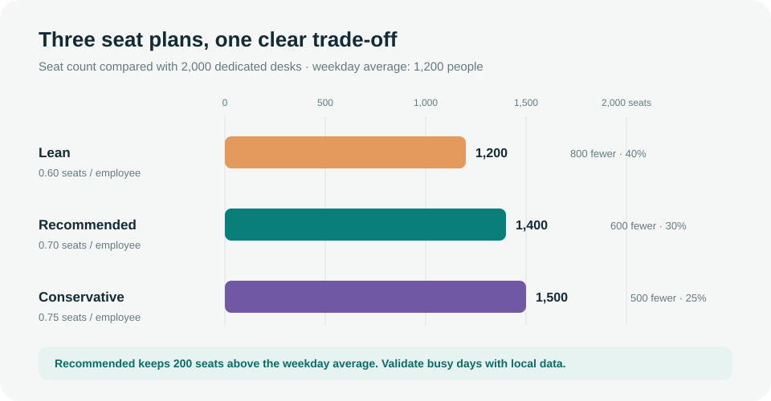
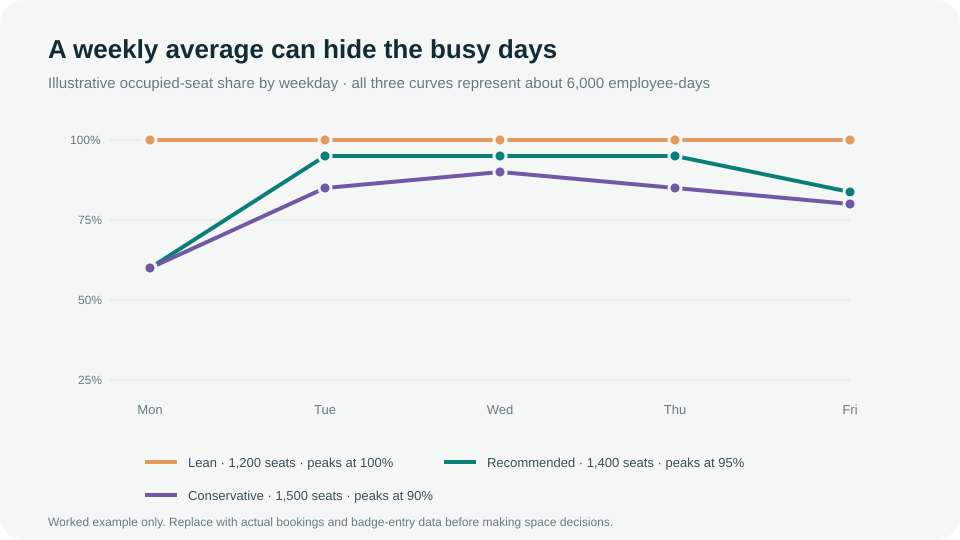
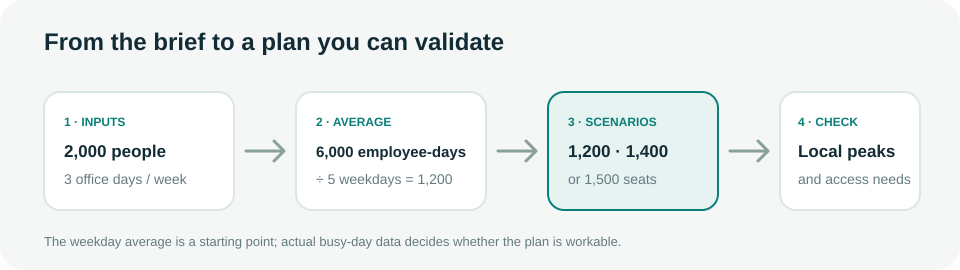

# WorkInSync | Hybrid seat planning

A small planning dashboard for one practical question: **how many shared seats could support 2,000 employees who work in the office three days a week across three locations?**

The dashboard compares three seat plans, shows how the choice changes the weekday occupancy picture, and lists the checks to complete before changing office capacity.

## Submission summary

The starting recommendation is **1,400 shared seats** across Bangalore, London, and New York. That is 0.70 seats per employee: **600 fewer desks** than a one-desk-per-person setup, while leaving **200 seats above the calculated weekday average of 1,200 people**.

This is a portfolio-level planning case. The brief does not include attendance history or employee counts by office, so 1,400 is a scenario to validate, not a final office-by-office allocation. Check actual Tuesday-to-Thursday peaks, team schedules, and accessibility needs before reducing space.

## The numbers behind the choice

The brief assumes that all 2,000 employees attend three days in a five-day week:

```text
2,000 employees × 3 office days = 6,000 employee-days each week
6,000 employee-days ÷ 5 weekdays = 1,200 people per weekday on average
```

The weekday average helps set a baseline. It does not tell us how many people arrive on the busiest day.

| Plan | Calculation | Seats | Seats per employee | Fewer than 2,000 dedicated desks | Above weekday average |
| --- | --- | ---: | ---: | ---: | ---: |
| **Lean** | 2,000 × 0.60 | **1,200** | 0.60 | 800 (40%) | 0 |
| **Recommended** | 2,000 × 0.70 | **1,400** | 0.70 | 600 (30%) | 200 |
| **Conservative** | 2,000 × 0.75 | **1,500** | 0.75 | 500 (25%) | 300 |



### Why keep all three plans?

- **Lean — 1,200 seats:** matches the weekday average and removes the most desks. It leaves no capacity above that average, so it depends on attendance being spread across the week. A busier day could exceed the plan.
- **Recommended — 1,400 seats:** keeps 200 seats above the average and removes 600 desks from the 1:1 baseline. It is a balanced starting point, but each office’s peak still needs checking.
- **Conservative — 1,500 seats:** keeps 300 seats above the average and removes 500 desks. It leaves more room for variation, with a smaller reduction in the dedicated-seat count.

The terms “lean,” “recommended,” and “conservative” describe these scenarios; they are not universal workplace standards.

## Weekday trend: how to read it

The line chart uses illustrative occupancy percentages to show what each seat plan could look like if roughly 6,000 employee-days were spread over the week. These are **worked examples, not observed attendance data**.



- **Lean stays at 100% each weekday** in this example. The plan uses all 1,200 seats even on an average day, leaving no room for attendance to bunch up.
- **Recommended peaks at 95%** on Tuesday through Thursday. Its example curve leaves a small peak-day cushion, but local booking and entry records must confirm whether 1,400 seats are enough.
- **Conservative peaks at 90%** in the example. It has the largest seat buffer of the three plans and the smallest reduction from the 2,000-desk baseline.

The curves are rounded and constructed to represent the same weekly employee-day total. They explain the trade-off between average demand and busy days; they do not predict actual occupancy for any of the three offices.

## How the decision is built



1. Start with the stated population and in-office rhythm.
2. Convert weekly employee-days into a weekday average.
3. Compare 0.60, 0.70, and 0.75 seats per employee.
4. Validate the selected portfolio total against actual peak-day demand at each location.

## What is in the dashboard

- **Dashboard:** the submission summary, scenario controls, seat comparison, and selected-plan charts. Choosing a plan updates the seat count, recommendation, calculation, and charts.
- **Sources:** research and practitioner reading, with direct links to the referenced material.
- **Scenarios:** the trade-offs behind Lean, Recommended, and Conservative. Selecting a plan highlights it here.
- **Trends:** a weekday comparison that emphasizes the selected plan while keeping the other two visible.
- **Action plan:** add suggested workstreams or create a custom item, then mark it complete or reopen it. Items are saved in this browser only; they do not sync to another device or a task-management system.

The dashboard suggests 95% desk availability, 85% booking use, and a 4.0/5 satisfaction floor as pilot guardrails. They are targets to consider, not reported company results.

## Assumptions and checks before using the plan

This exercise includes **2,000 employees, three offices, and three in-office days per employee each week**. It does not include office-level headcounts, booking or badge history, floor plans, lease costs, room mix, team schedules, or accessibility requirements.

Before making a capacity or lease decision:

- Compare several weeks of booking and badge-entry data by office and weekday.
- Check Tuesday-to-Thursday peaks and whether teams need to be onsite together.
- Keep accessible, specialist, and collaboration spaces in the plan.
- Agree on a service buffer and pilot the booking rules before scaling changes.
- Replace the illustrative curves with local data.

The utilization benchmarks below give context for the questions to ask. They are not inputs to the seat calculations and should not be treated as forecasts for this portfolio.

## References

- JLL, [*Global Occupancy Planning Benchmark Report 2025*](https://www.jll.com/content/dam/legacy/jll-com/documents/pdf/research/global/25-insights-global-occupancy-planning-benchmark-report-2025.pdf). The dashboard cites the report’s 54% global actual utilization and 79% target across its respondents.
- CBRE, [*2025 Americas Office Occupier Sentiment Survey*](https://www.cbre.com/insights/reports/2025-americas-office-occupier-sentiment-survey). Its peak-day findings offer U.S.-focused context, not an estimate for these offices.
- Kastle Systems, [*Back-to-Work Barometer*](https://www.kastle.com/resource/kastle-back-to-work-barometer-hits-all-time-post-pandemic-highs/).
- [Scheduling in Hybrid Work Environments](https://doi.org/10.1177/18479790261416541), *International Journal of Engineering Business Management*.
- [Stable Hot-Desking Allocation Algorithm](https://doi.org/10.1007/s00170-025-17283-z), *International Journal of Advanced Manufacturing Technology*.

## Run it locally

No build step or package installation is required. Open `index.html` in a modern browser. The page loads Tailwind CSS and Chart.js from CDNs, so an internet connection is needed for styling and interactive charts.

## Project files

| File | What it contains |
| --- | --- |
| `index.html` | Dashboard, scenario calculations, charts, source links, and action-plan interactions |
| `readme.md` | Submission summary, calculations, trend interpretation, assumptions, and run instructions |
| `docs/seat-scenarios.svg` | Scalable comparison of the three seat plans |
| `docs/weekday-occupancy.svg` | Illustrative weekday occupancy curves |
| `docs/decision-flow.svg` | Short diagram of the planning logic |
